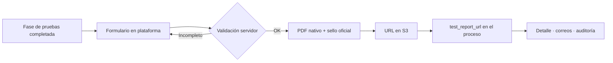
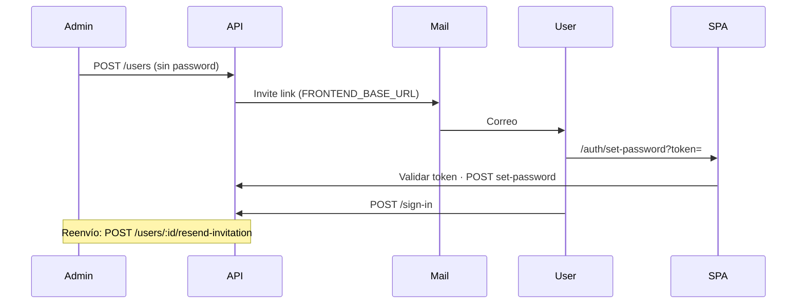

# Reporte de Mantenimiento Mensual

**Plataforma:** LBOneTrack (LB Technology SPA)  
**Cliente:** Camilo Espinoza — LBOneTrack  
**Desarrollador / Mantenedor:** Abisaid Farías  
**Período cubierto:** 1 – 30 de septiembre de 2026 *(+ cierre 1–4 octubre, sección 3.6)*  
**Fecha de emisión:** 4 de octubre de 2026  
**Repositorios:** `lbtechapi` (backend, Go) · `lbtechfront` (frontend, Angular)  
**Ambientes:** `dev` (api.testkoi.com · front [lbtechdev S3](http://lbtechdev.s3-website-us-east-1.amazonaws.com/)) · `prod` ([lbonetrack.com](https://lbonetrack.com/) · api.lbonetrack.com)

---

## En un vistazo

| Indicador | Valor |
|-----------|--------|
| **Entregas backend (`dev`)** | 6 commits en el período (5 en sep. + 1 cierre oct.) |
| **Foco principal** | Cierre del módulo Multi-banda (sellos oficiales, enlace del informe al proceso) + trazabilidad de creador |
| **Documentación** | Reportes de mantenimiento julio/agosto e investigación prod |
| **Nuevo (oct.)** | Autogestión de contraseñas e invitaciones por correo (backend listo; front en alineación) |
| **Pruebas** | Suite ampliada (p. ej. prototipo PDF Multi-banda en CI; tests de invite/validación de usuario) |

**Semáforo del mes:** 🟢 Entregas estables en dev · 🟡 Riesgos de infra/deps sin ciclo dedicado · 🟡 Front password pendiente de alineación

---

## Índice

1. [Resumen ejecutivo](#1-resumen-ejecutivo)  
2. [Contexto](#2-contexto--antecedente-del-mes-anterior)  
3. [Trabajo realizado](#3-trabajo-realizado-en-el-período)  
4. [Alcance recurrente mensual](#4-alcance-del-mantenimiento-recurrente-mensual)  
5. [Riesgos identificados](#5-riesgos-identificados)  
6. [Recomendaciones priorizadas](#6-recomendaciones-priorizadas)  
7. [Conclusión](#7-conclusión)  
8. [Mapa visual del mes](#mapa-visual-del-mes)  

---

## Mapa visual del mes

### Multi-banda: del borrador al informe en el proceso

### Cuentas de usuario: invitación y contraseña (entrega oct.)

> Los diagramas se renderizan en GitHub y en VS Code (extensión Markdown Preview Mermaid). Al exportar a PDF, usar la guía en [`README.md`](./README.md).

---

## 1. Resumen ejecutivo

Septiembre cerró el **módulo de Reporte Automático Multi-banda** que agosto había puesto en marcha: se incorporaron los **sellos oficiales** entregados por el cliente, se ajustó el layout del PDF (evidencia SW Version al mismo tamaño que SAE), y se **conectó el informe generado al propio proceso** (`test_report_url`), de modo que el flujo deja de depender de un upload manual paralelo.

En paralelo se añadió **trazabilidad de quién creó** cada multibanda y control de embarque (`created_by` → `requester_name` en listados), y se reforzó el login con **marcas del usuario** para que el front pueda filtrar sin pedir el perfil por separado.

Se publicó la **documentación de mantenimiento** de julio y agosto y notas de investigación de producción, como base continua para facturación y auditoría.

Los **primeros días de octubre** se entregó en backend la **autogestión de contraseñas**: alta de usuario sin contraseña admin, correo de invitación, olvidé mi contraseña, reenvío de invitación, y variables `FRONTEND_BASE_URL` en AWS Parameter Store para dev/prod. El frontend debe consumir estos endpoints (ver `docs/USER_PASSWORD_SELF_SERVICE.md`).

---

## 2. Contexto — antecedente del mes anterior

En **agosto** se entregó el módulo Multi-banda (formulario, validación servidor, PDF nativo, 36 pruebas) con **sellos provisionales**. El reporte de agosto dejó como bloqueante funcional la entrega de las **cinco imágenes definitivas** de sello.

Septiembre **sustituyó los placeholders por el arte oficial** (ocho variantes según bandas soportadas), con reglas de validación estrictas: un borrador con código de sello obsoleto **no puede emitirse** (evita imprimir un sello regulatorio incorrecto).

---

## 3. Trabajo realizado en el período

### Entregas del período (cronología)

| Fecha | Repo | Commit | Tema |
|-------|------|--------|------|
| 07-sep | api | `246dac2` | Sellos oficiales Multi-banda + layout evidencia SW |
| 07-sep | api | `16672ac` | `created_by` / `requester_name` + marcas en sign-in |
| 07-sep | api | `4b92a3f` | Docs mantenimiento julio/agosto + investigación prod |
| 08-sep | api | `5b1cd00` | Informe auto → `test_report_url` del proceso |
| 08-sep | api | `233859f` | Corrección de tests de entorno |
| 04-oct | api | `d6e6892` | Password self-service, resend invite, SSM/EB env |

### 3.1 Sellos oficiales y PDF Multi-banda (`246dac2`)

**Situación previa.** Los sellos eran placeholders; el código usaba una convención distinta a la del documento impreso.

**Qué se hizo.**

- Reemplazo por **ocho imágenes oficiales**; la convención del nombre indica **qué bandas sí soporta** el equipo (alineado al texto del sello físico).
- Códigos legacy retirados **sin alias automático**: un borrador antiguo falla en generación en lugar de mapear a un sello equivocado.
- Caja de sello ampliada (42 → 60 mm); captura **SW Version** al mismo alto que evidencias SAE.
- Handler HTTP corrige `Content-Type` según bytes reales (JPEG vs PNG).
- Test prototipo: regresión de layout en suite; PDF bajo demanda vía `MBR_PROTOTYPE_OUT`.

**Resultado.** El informe puede acercarse a uso **regulatorio real** una vez validado con el cliente; agosto’s blocker de sellos queda **resuelto en backend**.

### 3.2 Trazabilidad de solicitante (`16672ac`)

- `created_by` en multibanda y control de embarque; pipelines de listado proyectan **`requester_name`** (join a `users`, sin romper registros viejos).
- Sign-in incluye **brands** del usuario para scoping en front sin round-trip extra.

### 3.3 Informe automático ligado al proceso (`5b1cd00`)

- Tras generar el PDF, el proceso apunta a la URL en S3 vía **`test_report_url`** (detalle, correos de fase, etc.).
- Regeneración **actualiza** la URL con cache-bust; fallo al enlazar se propaga (no “éxito silencioso”).
- Updates que omiten `test_report_url` ya **no borran** el enlace existente (protección servidor).

### 3.4 Documentación operativa (`4b92a3f`)

- Reportes de mantenimiento **julio y agosto 2026**.
- Material de investigación prod enlazado desde `docs/mantenimiento/`.

### 3.5 Calidad y tests (`233859f`)

- Ajustes para que la suite pase en el entorno donde corre CI/despliegue (tests antes frágiles por entorno).

### 3.6 Cierre de ciclo — autogestión de contraseñas (1–4 octubre, `d6e6892`)

**Motivación.** El administrador no debe fijar contraseñas; el usuario activa la cuenta desde un enlace seguro.

**Backend entregado.**

| Capacidad | Detalle |
|-----------|---------|
| Alta de usuario | `POST /users` sin `password`; estado `pending`; correo de invitación |
| Reenvío | `POST /users/:id/resend-invitation` (solo pending; rate limit 1/min) |
| Público | `forgot-password`, `set-password`, validación de token |
| Usuario autenticado | `PUT /users/me/password` |
| Sign-in | `403` + `code: password_not_set` si aún no hay contraseña |
| Errores | `409` + `duplicate_email`; mensajes claros si falla SMTP/`FRONTEND_BASE_URL` |
| Despliegue | SSM: `FRONTEND_BASE_URL` dev/prod; `.ebextensions` carga URL en `.env` del contenedor |

**Pendiente coordinado.** Front Angular: rutas `/auth/set-password`, `/auth/forgot-password`, acción reenviar invitación, quitar password en alta (contrato en `USER_PASSWORD_SELF_SERVICE.md`).

**Ajuste UX (oct.).** `DELETE /users/:id` devuelve **404** si el usuario no existe (antes respondía 200 sin borrar nada, lo que confundía al recrear el mismo correo con 409). Al eliminar un usuario se revocan tokens de invitación/reset pendientes.

**Nota operativa.** En local, correos pueden ir a spam (enlaces localhost); en dev/prod usar URLs públicas ya configuradas en SSM.

### 3.7 Validación y despliegue

- Cambios integrados en rama **`dev`**; password self-service pusheado (`d6e6892`).
- Validación: `go test ./...` en backend; pruebas manuales de invite en local con Office365 SMTP.
- Producción: promover a `main`/EB cuando el front esté alineado y se valide E2E en dev.

---

## 4. Alcance del mantenimiento recurrente (mensual)

Sin cambio respecto a meses anteriores:

- Revisión de logs e infraestructura.
- Atención de defectos reportados o detectados.
- Dependabot / vulnerabilidades conocidas.
- Build, análisis estático y pruebas tras cambios.
- Despliegues dev/prod y documentación de incidentes.
- Ajustes de rendimiento ante incidentes.

---

## 5. Riesgos identificados

> Evidencia alineada al reporte de agosto; **no se ejecutó un ciclo dedicado de remediación** en septiembre.

### 5.1 Seguridad

| Riesgo | Estado | Notas |
|--------|--------|--------|
| Vulnerabilidades Dependabot (críticas/altas) | Abierto | GitHub sigue reportando deuda en dependencias |
| EB platform deprecated | Abierto | Migración de plataforma pendiente |
| CORS prod restrictivo | Vigilar | Solo dominios listados; confirmar que front prod coincide |
| **Nuevo:** tokens de contraseña | Mitigado en diseño | TTL, hash en BD, invalidación al reemitir invite |

### 5.2 Infraestructura

- Reportes de **movimiento** siguen con patrón headless (riesgo histórico documentado).
- Alertas automáticas 5xx/salud: sin cambio.

### 5.3 Código

- CI: conviene **ejecutar tests en pipeline** (más valor tras Multi-banda + password tokens).
- Front password self-service: **riesgo de desfase** API/front hasta completar UI.

---

## 6. Recomendaciones priorizadas

### Corto plazo

1. **Completar front** de password self-service y E2E en dev antes de prod.
2. **Desplegar** backend con `.ebextensions` actualizado para leer `FRONTEND_BASE_URL` desde SSM.
3. **Validar con cliente** un informe Multi-banda con sellos oficiales en PDF impreso.
4. Triage Dependabot (críticas primero).

### Mediano plazo

5. Tests obligatorios en pipeline CI.
6. Migrar reportes de movimiento a PDF nativo (cerrar último uso crítico de Chromium).
7. Alertas CloudWatch / salud EB.

### Largo plazo

8. Actualizar plataforma EB; observabilidad estructurada; reducir bus factor.

---

## 7. Conclusión

Septiembre **cerró funcionalmente el Multi-banda** respecto a sellos e integración del informe al proceso, y mejoró **trazabilidad y UX de listados**. Se consolidó la **línea documental** de mantenimiento mensual.

El arranque de octubre añade **seguridad y operación de cuentas** acorde a buenas prácticas (invitación por correo, sin contraseñas compartidas por admin), con infraestructura de enlaces ya preparada en AWS para dev y prod.

Los riesgos estructurales de **dependencias, plataforma EB y PDF headless en movimiento** siguen abiertos y conviene planificarlos, no solo documentarlos.
