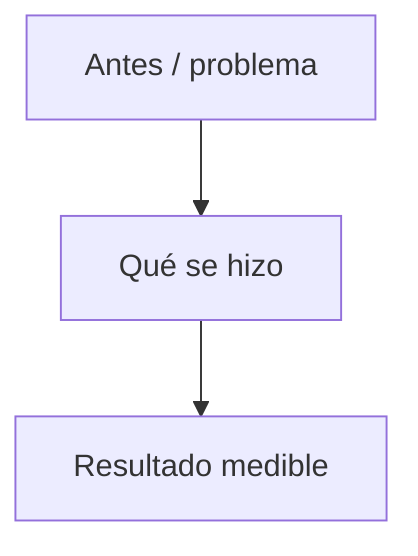

# Reporte de Mantenimiento Mensual

**Plataforma:** LBOneTrack (LB Technology SPA)  
**Cliente:** Camilo Espinoza — LBOneTrack  
**Desarrollador / Mantenedor:** Abisaid Farías  
**Período cubierto:** 1 – __ de __________ de 20__  
**Fecha de emisión:** __ de __________ de 20__  
**Repositorios:** `lbtechapi` (backend, Go) · `lbtechfront` (frontend, Angular)  
**Ambientes:** `dev` · `prod` ([lbonetrack.com](https://lbonetrack.com/))

---

## En un vistazo

| Indicador | Valor |
|-----------|--------|
| **Entregas backend** | |
| **Entregas frontend** | |
| **Foco principal** | |
| **Incidentes / defectos prod** | Ninguno / _(describir)_ |
| **Pruebas / CI** | |

**Semáforo del mes:** 🟢 Estable · 🟡 Riesgos documentados · 🔴 Incidente prod _(tachar lo que no aplique)_

---

## Índice

1. [Resumen ejecutivo](#1-resumen-ejecutivo)  
2. [Contexto](#2-contexto--antecedente-del-mes-anterior)  
3. [Trabajo realizado](#3-trabajo-realizado-en-el-período)  
4. [Alcance recurrente mensual](#4-alcance-del-mantenimiento-recurrente-mensual)  
5. [Riesgos identificados](#5-riesgos-identificados)  
6. [Recomendaciones priorizadas](#6-recomendaciones-priorizadas)  
7. [Conclusión](#7-conclusión)  
8. [Mapa visual del mes](#mapa-visual-del-mes)  

---

## Mapa visual del mes

_(Un diagrama Mermaid del hito principal — copiar y adaptar.)_

---

## 1. Resumen ejecutivo

_(2–4 párrafos: qué importó, qué se entregó, impacto para el usuario.)_

---

## 2. Contexto — antecedente del mes anterior

_(Enlace al reporte previo y pendientes heredados.)_

---

## 3. Trabajo realizado en el período

### Entregas del período (cronología)

| Fecha | Repo | Commit | Tema |
|-------|------|--------|------|
| | api / front | | |

### 3.1 _(Título entrega principal)_

**Situación previa.**  
**Qué se hizo.**  
**Resultado.**

### 3.2 _(Opcional)_

### 3.x Validación y despliegue

- Rama · pipeline · ambiente validado antes de prod.

---

## 4. Alcance del mantenimiento recurrente (mensual)

- Revisión de logs · defectos · Dependabot · build/tests · despliegues · documentación · rendimiento.

---

## 5. Riesgos identificados

### 5.1 Seguridad

| Riesgo | Estado | Notas |
|--------|--------|--------|

### 5.2 Infraestructura

### 5.3 Código / operación

---

## 6. Recomendaciones priorizadas

### Corto plazo

1.

### Mediano plazo

### Largo plazo

---

## 7. Conclusión

_(Cierre en 1–2 párrafos.)_
